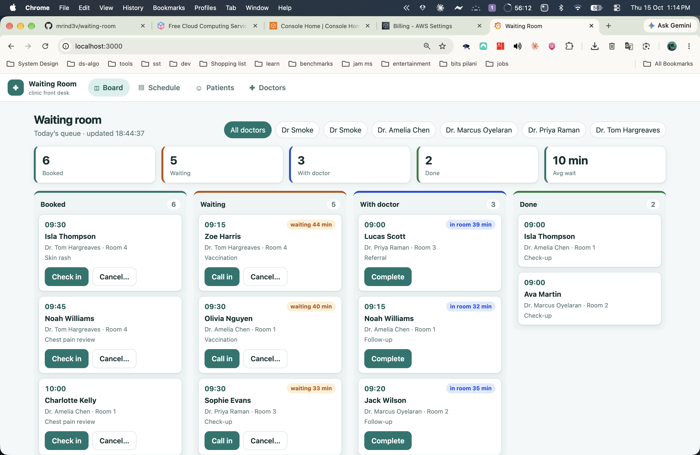
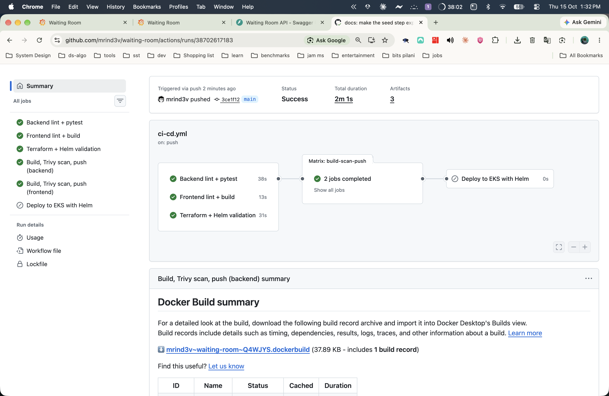
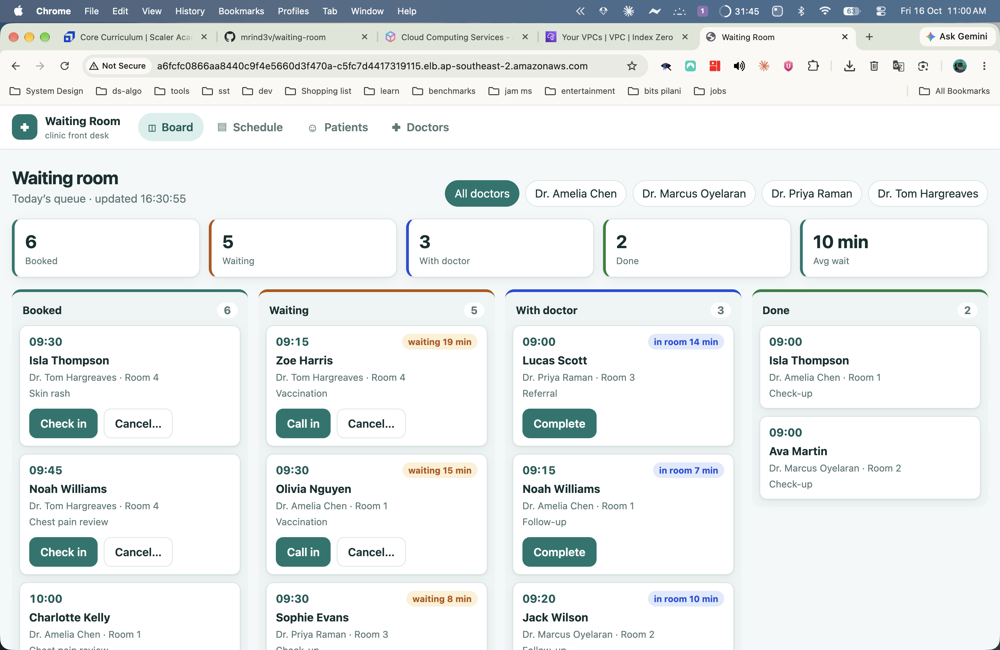
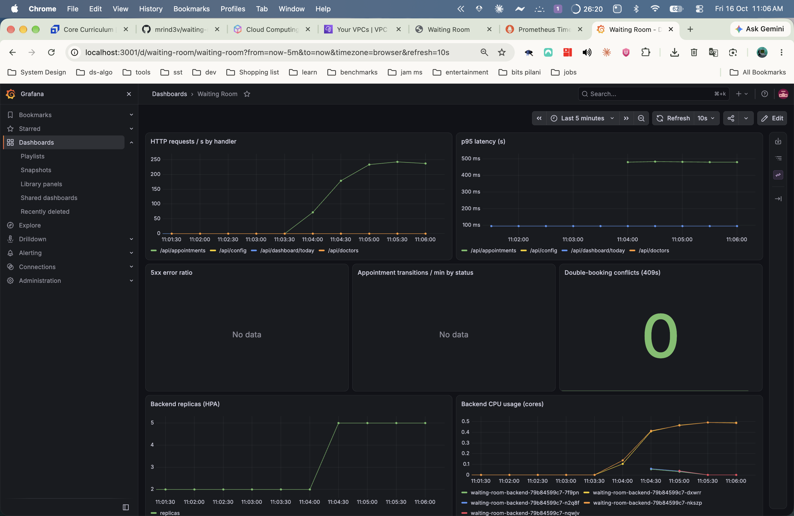

# Waiting Room

A clinic front-desk and queue system. Reception books appointments for doctors, checks patients in
as they arrive, and a live board shows who is waiting, who is with a doctor and how long each person
has waited. The same codebase ships through a full DevOps pipeline: tests, Docker, GitHub Actions,
Trivy, GHCR, Terraform (AWS VPC + EKS), Kubernetes, Helm, Ingress, HPA, Prometheus and Grafana.

> DevOps capstone project. Domain, schema, API and UI are original; only the pipeline architecture
> follows the course reference.

## For reviewers

| Start here | What you get |
|---|---|
| **[Presentation (PDF)](docs/presentation/Waiting-Room-Presentation.pdf)** | The whole project in 40 slides: app, tests, Docker, pipeline, Terraform, Kubernetes, monitoring, lessons. Opens in the browser |
| [Presentation (PowerPoint)](docs/presentation/Waiting-Room-Presentation.pptx) | The same deck with speaker notes (GitHub offers it as a download) |
| [Screenshots](docs/screenshots/) | Evidence for every grading module |
| [Submission guide](docs/SUBMISSION.md) | Which screenshot proves which rubric item |
| [Green pipeline runs](../../actions) | Tests, Trivy scan, image push and deploy on every commit |

The AWS stack (VPC + EKS) ran for one short window to capture the evidence, then Terraform destroyed
it and a verification script confirmed nothing was left (`ALL CLEAN`). The live URL is therefore
gone by design; the screenshots and the recorded numbers in the deck are the proof.

## What it does

| Screen | Purpose |
|---|---|
| **Board** | Four columns (Booked, Waiting, With doctor, Done) with live waiting timers, KPIs and a doctor filter |
| **Schedule** | Per-doctor day timeline from working hours and slot length; click a free slot to book |
| **Patients** | Search, register, edit and delete patients (duplicate phones and patients with appointments are rejected) |
| **Doctors** | Specialty, room, working hours and slot length; deactivate instead of delete |

**Appointment status flow**

```text
BOOKED ──► CHECKED_IN ──► IN_CONSULTATION ──► DONE
   │            │
   └──► CANCELLED ◄─┘      (DONE and CANCELLED are terminal; illegal moves return 409)
```

**Double-booking is impossible.** A PostgreSQL exclusion constraint
(`EXCLUDE USING gist (doctor_id WITH =, tstzrange(starts_at, ends_at, '[)') WITH &&) WHERE status <> 'CANCELLED'`)
rejects any overlapping appointment for the same doctor, even when two receptionists click at the same
millisecond. Back-to-back slots are allowed and cancelling frees the slot. The API turns the violation
(SQLSTATE `23P01`) into `409 SLOT_TAKEN`; a concurrency test proves exactly one of two simultaneous
bookings wins.

## Architecture

```text
 browser ─► Ingress (Traefik, 1 NLB on AWS)
              ├── /api ─► backend Service ─► FastAPI pods (HPA 2–5) ─► PostgreSQL StatefulSet (PVC)
              └── /    ─► frontend Service ─► nginx (unprivileged) pods (HPA 2–4)
 Prometheus ─scrapes /metrics via ServiceMonitor─► Grafana dashboard "Waiting Room"

 git push ─► GitHub Actions: lint+pytest │ frontend build │ terraform/helm validate
              └─► build ─► Trivy (fail HIGH/CRITICAL) ─► push ghcr.io/…:<git-sha> ─► helm upgrade --install
```

See [docs/ARCHITECTURE.md](docs/ARCHITECTURE.md) for design decisions and trade-offs.

## Run it locally

Requirements: Docker. (For the cluster: kind, kubectl, helm. For development: Python 3.12, Node 22, uv.)

```bash
cp .env.example .env        # set POSTGRES_PASSWORD
docker compose up --build   # db → migrate → backend → frontend
make seed                    # demo data (a fresh database is empty)
open http://localhost:3000   # API docs: http://localhost:8000/docs
```

Tests (real PostgreSQL, separate `waitingroom_test` database):

```bash
docker compose up -d db
cd backend && uv venv --python 3.12 && uv pip install -r requirements-dev.txt
set -a && . ../.env && set +a && .venv/bin/pytest -v
```

Local Kubernetes (same Helm chart that goes to EKS):

```bash
make kind-up                              # kind + Traefik + metrics-server + Prometheus/Grafana
make kind-deploy SHA=<commit-sha-built-by-ci>
open http://waiting-room.localtest.me:8080
./scripts/load-test.sh                    # watch the HPA scale the backend
```

## API

| Method | Path | Notes |
|---|---|---|
| GET | `/health` · `/ready` · `/metrics` | liveness · readiness (DB + migration head, 503 if not) · Prometheus |
| GET/POST | `/api/doctors` | list (`?active=`), create |
| PUT | `/api/doctors/{id}` | update / activate |
| GET | `/api/doctors/{id}/availability?date=` | slot grid with `available` flags |
| GET/POST | `/api/patients` | search (`?q=`), register (409 duplicate phone) |
| GET/PUT/DELETE | `/api/patients/{id}` | detail with upcoming appointments, update, delete (409 if appointments) |
| GET/POST | `/api/appointments` | day list (`date`, `doctor_id`, `status`), book (409 `SLOT_TAKEN`) |
| GET/PUT/DELETE | `/api/appointments/{id}` | detail, reschedule (only while BOOKED), delete (only CANCELLED) |
| POST | `/api/appointments/{id}/status` | `{status, cancel_reason?}` (409 `INVALID_TRANSITION`) |
| GET | `/api/dashboard/today` | counts per status, average wait, next up |

Errors are always `{"detail": "...", "code": "..."}`.

## CI/CD

`.github/workflows/ci-cd.yml` runs on every push and PR to `main`:

1. **backend-test**: ruff + pytest against a Postgres service container (a failure stops everything)
2. **frontend-build**: eslint + production build
3. **infra-lint**: `terraform fmt/validate`, `helm lint`, kubeconform on rendered manifests
4. **build-scan-push** (backend and frontend): build, **Trivy** (`HIGH,CRITICAL`, fails the job), then push `ghcr.io/mrind3v/waiting-room-{backend,frontend}:<git-sha>`. Never `latest`.
5. **deploy**: `helm upgrade --install --atomic` to EKS, only when repo variable `DEPLOY_ENABLED=true` (the short AWS window).

All third-party actions are pinned to full commit SHAs (the Trivy action was compromised via mutable tags in March 2026, which is exactly why).

## Security notes

- Both images run as non-root (uid 10001 / 101); pods use a restricted security context, read-only root filesystems, dropped capabilities and `RuntimeDefault` seccomp.
- No secrets in git: database and Grafana passwords are generated inside the cluster; CI uses a short-lived IAM user that is destroyed with the stack.
- CORS is closed by default (same-origin through the proxy/Ingress).
- Dependencies, base images (digest-pinned), Helm charts and Terraform modules are pinned; Dependabot keeps them current.

## Cost

AWS ran for one short window only (about **$0.26/hour**: EKS control plane, one `m7i-flex.large`,
one NLB), then everything was destroyed and verified. All development and testing happens in Docker
Compose and a local kind cluster; a $100 budget with six alerts guards the account. Terraform uses public
subnets only (no NAT gateway), no RDS and no KMS key. Procedure and teardown checks:
[docs/RUNBOOK-AWS.md](docs/RUNBOOK-AWS.md).

## Evidence

<table>
<tr>
<td width="50%"><br><sub>The live queue board (Docker Compose)</sub></td>
<td width="50%"><br><sub>Green pipeline: tests, Trivy, push, deploy</sub></td>
</tr>
<tr>
<td width="50%"><br><sub>The app on EKS behind one load balancer</sub></td>
<td width="50%"><br><sub>Grafana dashboard on the EKS cluster</sub></td>
</tr>
</table>

All screenshots, one per grading item, are in [docs/screenshots](docs/screenshots/) and mapped in
[docs/SUBMISSION.md](docs/SUBMISSION.md).

## Repository layout

```text
backend/    FastAPI app, Alembic migrations, pytest suite, Dockerfile
frontend/   React + Vite app, nginx config, Dockerfile
helm/       waiting-room chart (+ Grafana dashboard JSON)
k8s/        namespaces, kind config, EKS StorageClass and CI RBAC
terraform/  VPC + EKS (ap-southeast-2)
monitoring/ Prometheus/Grafana, Traefik and metrics-server values
scripts/    cluster bootstrap, load test, pre-destroy, teardown verification
troubleshooting/  three broken manifests with a diagnosis guide
docs/       architecture, AWS runbook, security scan, versions, submission guide,
            presentation/ (PDF + PowerPoint), screenshots/
```
